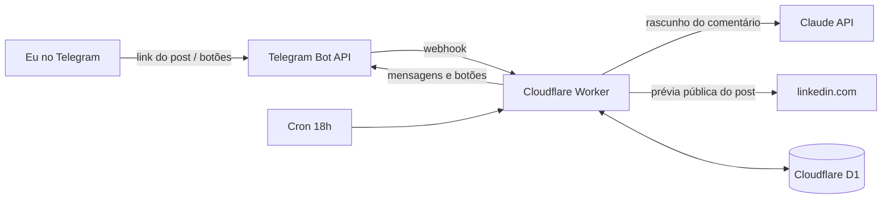

# SSI Copilot

Um copiloto pessoal para aumentar o **SSI (Social Selling Index) do LinkedIn** sem depender de memória e sem arriscar a conta.

## O problema

Subir o SSI exige constância: comentar em posts, publicar conteúdo e ampliar a rede com as pessoas certas. O difícil não é saber o que fazer, é **lembrar de fazer todo dia**.

Automatizar tudo com bots resolveria a constância, mas o LinkedIn proíbe automação em contas pessoais e restringe quem usa. Seria arriscar justamente o perfil que se quer valorizar.

## A solução: automação com aprovação humana

O sistema faz a parte chata (lembrar, ler, escrever o rascunho) e deixa para mim só a decisão, em poucos toques pelo Telegram.

| Quando | O que acontece | Quem faz |
|---|---|---|
| Durante o dia | Vejo um post bom e mando o link para o bot | Eu (2 segundos) |
| **Todo dia, 18h** | O bot manda uma sugestão de comentário para cada post salvo, no meu tom | Claude |
| | Aprovo, peço outra versão, edito ou pulo; depois colo no LinkedIn | Eu |
| **Sexta** *(fase 3)* | Carrossel em PDF sobre um tema, publicado pela API oficial após minha aprovação | Claude + API do LinkedIn |
| **Sábado** *(fase 4)* | Lista de recrutadores da minha área com notas de conexão prontas | Claude + busca pública |
| **Domingo** *(fase 2)* | Resumo da semana e dashboard das ações | Bot |

Nada é publicado ou enviado no LinkedIn sem eu ver antes.

## Arquitetura



- **Cloudflare Workers**: o bot fica sempre no ar (os botões respondem na hora) e os horários rodam pelos Cron Triggers. Cabe no plano grátis.
- **Cloudflare D1** (SQLite): posts salvos, estado da conversa e o registro de ações que alimenta o resumo.
- **Claude API**: escreve os comentários a partir de um perfil de tom editável em [`src/perfil.ts`](src/perfil.ts).
- **GitHub Actions**: roda os testes e publica o Worker a cada push na `main`.

O código do bot não conhece Telegram, D1 nem Claude diretamente: tudo passa por interfaces em [`src/types.ts`](src/types.ts). Por isso os testes rodam sem rede, e trocar o Telegram pelo WhatsApp é escrever um novo `Messenger`.

## Como usar o bot

1. No app do LinkedIn, toque em **Compartilhar → Enviar** num post e mande o link para o bot. Se quiser, cole o texto do post junto.
2. Se o LinkedIn não deixar ler o post pelo link, o bot pede o texto.
3. Às 18h chegam as sugestões, cada uma com **✅ Aprovar · 🔄 Outra versão · ✏️ Editar · ❌ Pular**.
4. Ao aprovar, o comentário vem pronto para copiar. Depois de colar no LinkedIn, toque em **✔️ Já comentei** para contar no resumo.

Comandos: `/agora` (gera as sugestões na hora), `/fila`, `/semana`, `/ajuda`.

## Configuração (uma vez)

### 1. Criar as chaves

| Segredo | Onde conseguir |
|---|---|
| `TELEGRAM_BOT_TOKEN` | No Telegram, fale com [@BotFather](https://t.me/BotFather) → `/newbot` |
| `ANTHROPIC_API_KEY` | [console.anthropic.com](https://console.anthropic.com) → API Keys |
| `CLOUDFLARE_API_TOKEN` | Cloudflare → My Profile → API Tokens → modelo **Edit Cloudflare Workers**, com permissão extra **D1: Edit** |
| `CLOUDFLARE_ACCOUNT_ID` | Cloudflare → Workers & Pages → lado direito da página (Account ID) |

### 2. Cadastrar no GitHub

Em **Settings → Secrets and variables → Actions → New repository secret**, crie os quatro segredos acima com esses nomes exatos.

### 3. Publicar

Faça um push na `main` (ou rode o workflow **Deploy** em Actions). Ele:
1. roda os testes;
2. cria o banco D1, se ainda não existir, e aplica as migrações;
3. publica o Worker e grava os segredos nele;
4. registra o webhook do Telegram.

Se for a primeira vez usando Workers, ative o subdomínio `workers.dev` em **Workers & Pages** no painel da Cloudflare.

### 4. Começar

Abra o bot no Telegram e mande `/start`. O primeiro chat que mandar `/start` vira o dono; qualquer outra pessoa recebe "bot pessoal".

## Desenvolvimento

```bash
npm install
npm test          # testes (sem rede)
npm run typecheck
```

## Roadmap

- [x] **Fase 1**: salvar posts pelo Telegram, sugestões às 18h, aprovar/editar/pular, registro de comentários
- [ ] **Fase 2**: resumo de domingo, registro do SSI semanal e dashboard público das ações
- [ ] **Fase 3**: carrossel de sexta (slides → PDF) publicado pela API oficial do LinkedIn
- [ ] **Fase 4**: lista de sábado com 50 recrutadores da área e notas de conexão

## Licença

MIT
