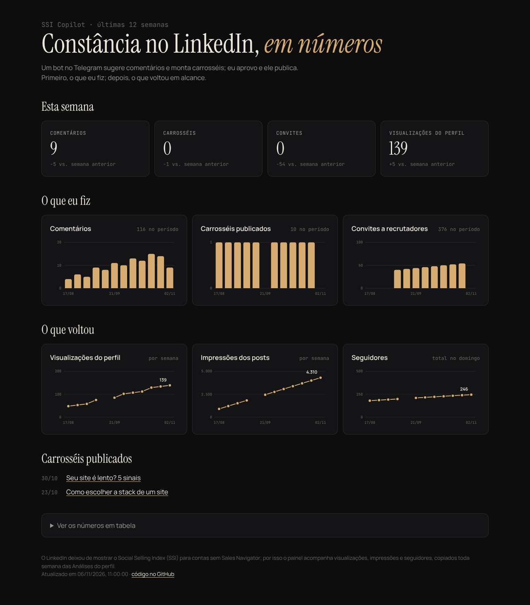
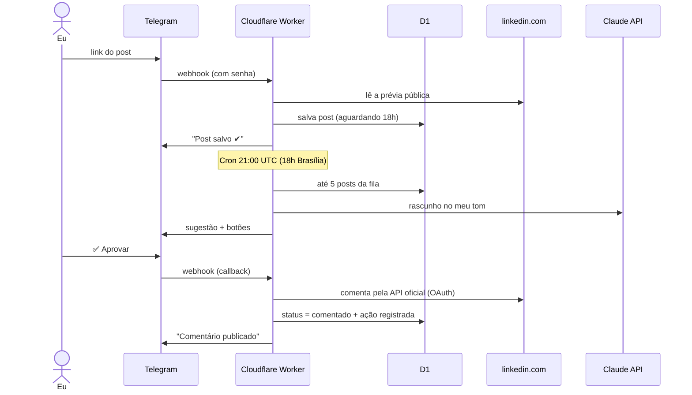
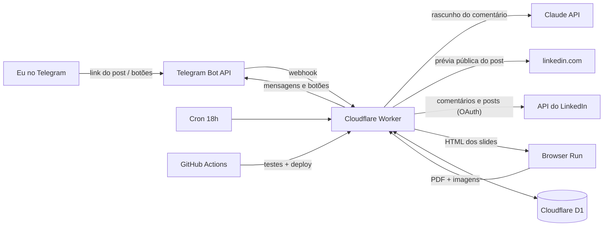

# SSI Copilot

Um copiloto pessoal para manter constância no LinkedIn (comentar, publicar e ampliar a rede) sem depender de memória e sem arriscar a conta.

> Nasceu para subir o **SSI (Social Selling Index)**. Em 2026 o LinkedIn deixou de mostrar o SSI para contas sem Sales Navigator, então o projeto passou a medir o que continua visível de graça: visualizações do perfil, impressões e seguidores. Os hábitos que o SSI premiava são os mesmos.

**Painel ao vivo:** [ssi-copilot.matheusferrazza.workers.dev/dashboard](https://ssi-copilot.matheusferrazza.workers.dev/dashboard)



## O problema

Subir o SSI exige constância: comentar em posts, publicar conteúdo e ampliar a rede com as pessoas certas. O difícil não é saber o que fazer, é **lembrar de fazer todo dia**.

Automatizar tudo com bots resolveria a constância, mas o LinkedIn proíbe automação em contas pessoais e restringe quem usa. Seria arriscar justamente o perfil que se quer valorizar.

## A solução: automação com aprovação humana

O sistema faz a parte chata (lembrar, ler, escrever o rascunho) e deixa para mim só a decisão, em poucos toques pelo Telegram.

| Quando | O que acontece | Quem faz |
|---|---|---|
| Durante o dia | Vejo um post bom e mando o link para o bot | Eu (2 segundos) |
| **Todo dia, 18h** | O bot manda até 3 sugestões de comentário, no meu tom | Claude |
| | Aprovo (o bot publica no LinkedIn), peço outra versão, edito ou pulo | Eu + API do LinkedIn |
| **Quando eu quiser** | Mando `/carrossel <tema>`; o Claude monta os slides e eu aprovo a prévia | Eu + Claude |
| **Sexta, 18h** | O carrossel aprovado é publicado no meu perfil | API do LinkedIn |
| **Durante a semana** | Mando convites de conexão no LinkedIn e registro quantos com `/convites 10`; o bot mostra quanto falta para a meta de 50 | Eu |
| **Domingo, 18h** | Resumo da semana; mando 3 números das Análises do LinkedIn | Bot + eu (30 segundos) |
| **Sempre** | Painel público com ações e resultados das últimas 12 semanas | Worker |

Nada é publicado ou enviado no LinkedIn sem eu ver antes. Isso respeita os termos da plataforma, protege a conta e garante que nada sai com o meu nome sem revisão.

## Como usar o bot

**Comentários**
1. No app do LinkedIn, toque em **Compartilhar → Enviar** num post e mande o link para o bot. Se quiser, cole o texto do post junto.
2. Se o LinkedIn não deixar ler o post pelo link, o bot pede o texto.
3. Às 18h chegam até 3 sugestões, cada uma com **✅ Aprovar · 🔄 Outra versão · ✏️ Editar · ❌ Pular**.
4. **✅ Aprovar** (ou mandar a versão editada) publica o comentário direto no post, pela API oficial. Se o LinkedIn recusar, o bot explica o motivo e manda o texto pronto para copiar.

**Convites da semana**
1. Mandei convites no LinkedIn? `/convites 10` soma na semana (segunda a domingo). Errei? `/convites -2` corrige.
2. A resposta mostra o total e quanto falta para a meta: "🤝 Convites: 32 de 50 (faltam 18)". `/convites` sozinho só mostra.
3. Passando de ~100 na semana, o bot avisa: é perto do limite em que o LinkedIn começa a restringir.
4. O total entra no `/semana`, no resumo de domingo e no gráfico do painel.

**Carrossel de sexta**
1. `/carrossel how to choose a website stack`: o Claude **pesquisa na web** dados sobre o tema e escreve o carrossel **em inglês**, curto: **de 3 a 5 slides** (capa + 1 a 3 de conteúdo + fechamento), de preferência 3.
2. **A capa (slide 1) sempre tem um gráfico**: o dado mais forte vira o gancho. No total são até 3 gráficos; os outros slides podem ser só texto. Com dado de pesquisa, o gráfico leva a fonte ("Source: …, 2025") embaixo de cada gráfico. Sem dado confiável, o gráfico sai marcado como **"Illustrative data, not a measurement"**.
3. Chegam as imagens dos slides e o cartão com as fontes, o custo daquele carrossel (tokens, buscas e US$) e os botões **✅ Aprovar · 🔄 Refazer · ✏️ Ajustar · ❌ Descartar**. Ajustar reaproveita a pesquisa (sem novo custo de busca); Refazer pesquisa de novo.
4. Aprovado, ele entra na **próxima sexta livre**, às 18h. Se a próxima sexta já tem um, vai para a seguinte, e assim por diante. `/agenda` mostra a fila; descartar um agendado libera a sexta dele.
5. Na quinta, se não houver carrossel para o dia seguinte, o bot pergunta o tema. Se a publicação falhar, manda o PDF e a legenda para postar à mão.

| Comando | O que faz |
|---|---|
| `/conectar` | Conecta o LinkedIn (OAuth) ou mostra até quando a conexão vale |
| `/carrossel <tema>` | Cria o carrossel da semana |
| `/agora` | Gera as sugestões na hora, sem esperar as 18h |
| `/agenda` | Carrosséis aprovados, com a sexta de cada um |
| `/status` | Versão publicada, quando a fila rodou pela última vez e quantos pedidos estão esperando ou com erro |
| `/temas` | 8 temas em alta (software, front-end e IA), cada um com gancho, motivo e fonte; um toque monta o carrossel |
| `/fila` | Mostra os posts salvos e em que etapa cada um está |
| `/semana` | Resumo da semana (segunda a domingo), comparado com a anterior |
| `/metricas 120 3400 215` | Registra visualizações do perfil, impressões e seguidores da semana |
| `/painel` | Link do dashboard |
| `/convites 10` | Registra convites enviados; sozinho, mostra quantos faltam para a meta da semana |
| `/ajuda` | Explica como usar |

---

## Como funciona por dentro

### O caminho de uma mensagem



### Arquitetura



### Stack e por que cada peça

| Peça | Papel | Por que ela | Alternativa descartada |
|---|---|---|---|
| **Telegram Bot API** | Interface: receber links e mostrar botões | Grátis, pronto em 2 minutos, botões nativos, webhook instantâneo | WhatsApp: a API oficial exige conta Business, um número separado e modelos aprovados, e cobra por conversa; as bibliotecas não oficiais arriscam banir o número |
| **Cloudflare Workers** | Onde o código roda | Serverless e sempre no ar: responde ao webhook em milissegundos. Tem horários agendados (Cron Triggers) e o plano grátis cobra esse uso com folga | GitHub Actions: só roda em horários marcados, então os botões demorariam minutos. VPS: custa e exige manutenção |
| **Cloudflare D1** | Banco de dados (SQLite) | SQL de verdade para consultas como "posts pendentes em ordem" e "ações por tipo na semana"; fica na mesma conta e de graça | KV: só chave e valor, sem consultas |
| **Claude API** (Sonnet 5.5) | Escreve comentários e carrosséis | Escrita natural em português e inglês, seguindo um perfil de tom; o carrossel volta em JSON validado (saída estruturada) | Opus: qualidade parecida em textos curtos pelo dobro do preço |
| **API do LinkedIn** | Comentar e publicar no meu perfil | Oficial (produto "Share on LinkedIn", escopo `w_member_social`): nada de bot ou automação de navegador | Extensões e bots: proibidos e arriscam a conta |
| **Cloudflare Browser Run** | Transformar o HTML dos slides em PDF e PNG | Um Chrome dentro da Cloudflare: os slides são HTML/CSS com as cores e fontes do meu site | Desenhar o PDF por código: mais trabalho e visual pior |
| **TypeScript** | Linguagem | Tipos pegam erros antes do deploy (ex.: um status de post que não existe) | JavaScript puro |
| **Wrangler** | CLI da Cloudflare | Publica o Worker, aplica migrações e grava segredos; o `wrangler.toml` descreve tudo em texto | Configurar à mão no painel |
| **GitHub Actions** | CI e deploy | Testa cada pull request e publica cada push na `main`, sem instalar nada no computador | Deploy manual |
| **Vitest** | Testes | Rápido, roda TypeScript direto; 150 testes em cerca de 1 segundo | Jest |

### Técnicas de engenharia

**Automação com aprovação humana (*human-in-the-loop*).** O sistema prepara, eu decido. É o que torna o projeto viável dentro das regras do LinkedIn.

**Injeção de dependências (portas e adaptadores).** A lógica em [`src/bot.ts`](src/bot.ts) não conhece Telegram, D1 nem Claude: só as interfaces `Messenger`, `Store` e `Drafter`, definidas em [`src/types.ts`](src/types.ts). O [`src/index.ts`](src/index.ts) liga cada interface à implementação real. Isso traz duas vantagens:
- nos testes entram versões falsas ([`test/fakes.ts`](test/fakes.ts)), então nada depende de rede;
- trocar o Telegram pelo WhatsApp é escrever um novo `Messenger`, sem mexer na lógica.

**Máquina de estados.** Cada post passa por estados bem definidos, e cada botão só faz uma transição válida:

```
falta o texto → aguardando 18h → sugestão enviada → aprovado → comentado
                                                  ↘ pulado
```

**Estado da conversa.** Quando o bot pede "cole o texto" ou "mande a sua versão", ele grava no banco o que está esperando (`awaiting`), e a próxima mensagem é interpretada nesse contexto. Mandar um link novo ou um comando cancela a espera.

**Webhook com `waitUntil`.** O Worker responde "ok" ao Telegram na hora e termina o trabalho em segundo plano. Sem isso, uma chamada demorada ao Claude faria o Telegram achar que a mensagem falhou e reenviá-la, gerando duplicatas.

**Engenharia de prompt.** O prompt de sistema é montado a partir de [`src/perfil.ts`](src/perfil.ts): quem eu sou, objetivo, tom, regras (2 a 4 frases, sem elogio vazio, sem hashtags, sem inventar experiência, no idioma do post) e exemplos meus. Mudar o tom é editar esse arquivo.
- O post vai entre tags `<post>`, separando o conteúdo das instruções. Um post que diga "ignore as regras" é tratado como texto, não como ordem.
- Em "Outra versão", o rascunho anterior vai junto com o pedido de um ângulo diferente.

**OAuth 2.0 com o LinkedIn.** `/conectar` gera um link com um `state` aleatório que vale 15 minutos. Na volta, o Worker confere o `state` (impede conexões forjadas), troca o código por um token de 60 dias e o guarda **criptografado com AES-GCM** ([`src/crypto.ts`](src/crypto.ts)). A senha do LinkedIn nunca passa pelo bot. Uma semana antes de vencer, o bot avisa para renovar.

**Slides 16:9.** Os slides são horizontais (1920×1080), como os outros posts do perfil: preenchem a largura do feed no computador. Nos slides com gráfico, o texto fica à esquerda e o gráfico à direita.

**Ilustração da capa com Flux.** O Claude descreve uma cena para a capa (`imagem_prompt`) e o Flux 1 Schnell, no Workers AI da Cloudflare, gera a ilustração, com um estilo fixo nas cores do site e sem texto na imagem ([`src/illustrator.ts`](src/illustrator.ts)). A capa fica com título e gráfico à esquerda e a ilustração na faixa direita. A imagem é guardada com o carrossel para a publicação de sexta; Ajustar reaproveita, Refazer gera outra; se falhar, o carrossel sai só com o gráfico. Cabe na cota grátis diária do Workers AI.

**Temas em alta (`/temas`).** O Claude busca na web o que desenvolvedores estão discutindo nas últimas semanas (lançamentos, pesquisas, debates) em software, front-end e IA, e sugere 8 temas com gancho e motivo. Como no carrossel, só entram temas cujo link apareceu nos resultados da busca. Não são as métricas internas do LinkedIn, que não têm API pública.

**Gráficos com fonte conferida, não inventada.** O carrossel é feito em dois passos ([`src/claude.ts`](src/claude.ts)):
1. *Pesquisa:* o Claude usa a busca na web e devolve de 3 a 6 dados com fonte, ano, link e os números como foram publicados. O código só aceita um dado se o **link apareceu de verdade nos resultados da busca** (ou nas citações), nunca no texto livre do modelo, e se tiver de 2 a 8 números.
2. *Escrita:* com saída estruturada, o Claude escreve os slides e escolhe, para cada gráfico, qual dado da pesquisa usar (pelo id) ou "ilustrativo". **Os números de um gráfico com fonte vêm da pesquisa conferida, nunca do texto escrito no segundo passo.** Um id que não existe vira ilustrativo, sem fonte.

**Custo medido por carrossel.** Os tokens de entrada e saída e as buscas dos dois passos vêm do `usage` da API e são convertidos em dólar pelo preço do Sonnet 5.5 (US$ 2 / US$ 10 por milhão de tokens; US$ 10 por mil buscas). O valor aparece no cartão de cada carrossel.

**Fila de sextas.** Cada carrossel aprovado guarda a sexta em que sai (`scheduled_for`). Aprovar outro pega a primeira sexta livre a partir da próxima; na sexta, sai só o da vez (ou um atrasado, se uma sexta passou sem publicar).

**Saída estruturada.** O carrossel é pedido com um JSON Schema: capa, lista de slides, fechamento e legenda. A API garante o formato, e o código ainda confere ([`normalizeCarousel`](src/carousel.ts)) antes de desenhar.

**Plano B em cascata na publicação.** Primeiro tenta como documento (o carrossel em PDF do LinkedIn). Se o LinkedIn negar, publica como post de várias imagens. Se ainda falhar, manda o PDF e a legenda para eu postar à mão. Comentários seguem a mesma ideia: se a API recusar, o texto vem pronto para copiar.

**Agenda por dia da semana.** Um único cron às 18h decide o que fazer pelo dia em Brasília: comentários todo dia, lembrete na quinta, publicação na sexta, resumo no domingo. As semanas vão de segunda a domingo no horário de Brasília ([`src/week.ts`](src/week.ts)); números enviados na segunda de manhã ainda contam para a semana do resumo.

**Fila para trabalhos longos.** Quando um pedido chega pelo Telegram, o Worker tem só ~30 segundos depois de responder. Montar um carrossel ou gerar várias sugestões pode levar mais que isso. Então o webhook só grava o pedido numa tabela `jobs` e avisa; um cron de cada minuto pega os pendentes (com `UPDATE … RETURNING`, para nenhum rodar duas vezes) e executa com até 15 minutos ([`src/index.ts`](src/index.ts)).

**Falhas avisam no Telegram.** O que roda sozinho (cron das 18h e fila) passa por um `guarded()`: se der erro, além do log da Cloudflare, chega no Telegram "⚠️ … falhou: motivo".

**Dashboard sem framework.** O painel ([`src/dashboard.ts`](src/dashboard.ts)) é HTML montado no próprio Worker, com gráficos em SVG desenhados no servidor: nenhuma biblioteca de gráficos, nenhum build. Cada medida tem o seu gráfico (escalas diferentes nunca dividem o mesmo eixo), semanas sem número viram lacuna na linha em vez de zero, só o último valor ganha rótulo, cada barra e ponto tem dica ao passar o mouse e há uma tabela com todos os números.

**Resiliência na API do Claude.** `fallbacks: "default"` faz a própria API tentar de novo em outro modelo se houver uma recusa por falso positivo. Se mesmo assim vier recusa (`stop_reason: "refusal"`), o bot avisa em vez de mandar um comentário vazio.

**Degradação graciosa na leitura do LinkedIn.** Quando só o link é enviado, a leitura tenta, em ordem:
1. JSON-LD (dados estruturados da página, que costumam trazer o texto completo e o autor);
2. metatags Open Graph (texto mais curto);
3. pedir o texto para mim.

O bot nunca trava por causa do LinkedIn.

**Segurança.**
- *Webhook autenticado:* o Telegram envia uma senha em cada chamada, e o Worker recusa as que não a têm. A senha é derivada do token do bot com SHA-256, então não há mais um segredo para gerenciar.
- *Bot com dono:* o primeiro `/start` grava o meu chat; outras pessoas recebem "bot pessoal" e os botões delas são ignorados.
- *Segredos fora do código:* as chaves ficam nos Secrets do GitHub e dentro do Worker, nunca no repositório. Por isso ele pode ser público.
- *Escape de HTML:* `<`, `>` e `&` vindos do post ou do comentário são convertidos antes de ir ao Telegram, evitando mensagens quebradas e injeção de formatação.

**Idempotência.** Tocar duas vezes em "✔️ Já comentei" registra uma ação só. Os números do resumo ficam confiáveis.

**Isolamento de erros.** Na rodada das 18h, uma falha num post gera um aviso sobre aquele post e os demais seguem.

**Controle de custo.** No máximo 3 sugestões por dia: segura o gasto com a API e mantém a rotina realista.

**Infraestrutura como código.** Worker, banco, tabelas ([`migrations/`](migrations)) e horários estão descritos no repositório. O script [`scripts/ensure-d1.mjs`](scripts/ensure-d1.mjs) só cria o banco se ele não existir, então o deploy pode rodar quantas vezes for preciso. As migrações numeradas evoluem o banco sem perder dados.

**Fuso horário.** Cron Triggers usam UTC: `0 21 * * *` = 18:00 em Brasília, que não tem horário de verão desde 2019.

### Estrutura do código

| Arquivo | O que faz |
|---|---|
| [`src/index.ts`](src/index.ts) | Entrada do Worker: rota do webhook, rota de setup e o cron |
| [`src/bot.ts`](src/bot.ts) | Toda a lógica: mensagens, botões, rodada das 18h |
| [`src/types.ts`](src/types.ts) | Tipos e interfaces (`Store`, `Messenger`, `Drafter`) |
| [`src/perfil.ts`](src/perfil.ts) | Meu tom, regras, exemplos e perfis que acompanho |
| [`src/claude.ts`](src/claude.ts) | Prompts e chamadas à Claude API (comentário e carrossel) |
| [`src/linkedin-api.ts`](src/linkedin-api.ts) | OAuth, comentar e publicar pela API oficial do LinkedIn |
| [`src/carousel.ts`](src/carousel.ts) | Modelo HTML dos slides e geração do PDF/imagens |
| [`src/crypto.ts`](src/crypto.ts) | Criptografia do token do LinkedIn |
| [`src/linkedin.ts`](src/linkedin.ts) | Extrair o link e ler a prévia pública do post |
| [`src/dashboard.ts`](src/dashboard.ts) | Painel: dados por semana e gráficos em SVG |
| [`src/week.ts`](src/week.ts) | Semanas de segunda a domingo no horário de Brasília |
| [`src/crons.ts`](src/crons.ts) | Horários do cron (conferidos contra o `wrangler.toml` num teste) |
| [`src/language.ts`](src/language.ts) | Detecta se o post está em português ou inglês |
| [`src/telegram.ts`](src/telegram.ts) | Cliente da Bot API (mensagens, álbum, PDF) e senha do webhook |
| [`src/store.ts`](src/store.ts) | Acesso ao D1 |
| [`migrations/`](migrations) | Estrutura do banco |
| [`test/`](test) | Testes e implementações falsas |
| [`.github/workflows/`](.github/workflows) | CI e deploy |

### Custos

| Serviço | Custo mensal |
|---|---|
| Cloudflare Workers + D1 + Browser Run + Workers AI (Flux) | Grátis (plano Free e cota diária do Workers AI) |
| API do LinkedIn | Grátis |
| Telegram | Grátis |
| GitHub Actions | Grátis (repositório público) |
| Claude API (Sonnet 5.5) | ~US$ 2–3 em créditos pré-pagos (3 comentários/dia e 4 carrosséis com pesquisa, ~US$ 0,15–0,30 cada) |

---

## Configuração (uma vez)

### 1. Criar as chaves

| Segredo | Onde conseguir |
|---|---|
| `TELEGRAM_BOT_TOKEN` | No Telegram, fale com [@BotFather](https://t.me/BotFather) → `/newbot`. O token vem na mensagem final (formato `números:letras`) |
| `ANTHROPIC_API_KEY` | [console.anthropic.com](https://console.anthropic.com): compre créditos (sem recarga automática) e crie a chave em API Keys |
| `CLOUDFLARE_API_TOKEN` | [dash.cloudflare.com/profile/api-tokens](https://dash.cloudflare.com/profile/api-tokens) → Create Token → modelo **Edit Cloudflare Workers** + linhas extras **Account → D1 → Edit**, **Account → Browser Run → Edit** e **Account → Workers AI → Edit** |
| `CLOUDFLARE_ACCOUNT_ID` | O código de 32 caracteres na URL do painel (`dash.cloudflare.com/<account_id>/home`) |

### 2. App do LinkedIn

1. Crie uma **Página de empresa** no LinkedIn (exigência para qualquer app; os posts continuam saindo no perfil pessoal).
2. Em [linkedin.com/developers/apps](https://www.linkedin.com/developers/apps), crie o app vinculado à página e clique em **Verify**.
3. Em **Products**, adicione **Sign In with LinkedIn using OpenID Connect** e **Share on LinkedIn**.
4. Em **Auth → Authorized redirect URLs**, adicione `https://ssi-copilot.<seu-subdominio>.workers.dev/linkedin/callback`.
5. Crie mais três segredos no GitHub:

| Segredo | Onde conseguir |
|---|---|
| `LINKEDIN_CLIENT_ID` | Aba Auth do app |
| `LINKEDIN_CLIENT_SECRET` | Aba Auth do app |
| `TOKEN_ENCRYPTION_KEY` | Gerado por você, ex.: `openssl rand -base64 32` |

### 3. Ativar o subdomínio `workers.dev`

No painel da Cloudflare, em **Workers & Pages**, registre um subdomínio (ex.: `seunome.workers.dev`). Sem isso o primeiro deploy falha.

### 4. Cadastrar no GitHub

Em **Settings → Secrets and variables → Actions → New repository secret**, crie os sete segredos com esses nomes exatos.

### 5. Publicar

Faça um push na `main` (ou rode o workflow **Deploy** em Actions). Ele:
1. roda typecheck e testes;
2. confere os segredos;
3. cria o banco D1, se ainda não existir, e aplica as migrações;
4. publica o Worker e grava os segredos nele (os do LinkedIn só se existirem);
5. registra o webhook e os comandos do Telegram.

### 6. Começar

Abra o bot no Telegram e mande `/start` (o primeiro chat que mandar vira o dono) e depois `/conectar` para ligar o LinkedIn.

## Desenvolvimento

```bash
npm install
npm test          # testes (sem rede)
npm run typecheck
```

## Roadmap

- [x] **Fase 1**: salvar posts pelo Telegram, sugestões às 18h, aprovar/editar/pular, registro de comentários
- [x] **Fase 2**: resumo de domingo, números semanais das Análises do LinkedIn e dashboard público
- [x] **Fase 3**: conexão OAuth com o LinkedIn, comentários publicados ao aprovar, carrossel com prévia e publicação na sexta
- [x] **Fase 4**: contador semanal de convites com meta (`/convites`). Uma versão anterior buscava 50 recrutadores por semana com a busca na web do Claude e abria os perfis em abas; saiu por ser trabalhosa demais no uso real, e ficou só o registro.

## Licença

MIT
